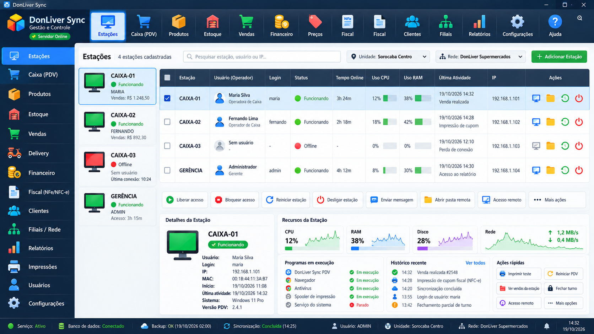

<h1>👋 Olá, eu sou Daniel Oliveira</h1>

<h3>AI-Assisted Developer · Workflow Automation · Digital Product Development</h3>

🎓 Graduado em Redes de Computadores &nbsp;•&nbsp; 🖧 Infraestrutura de TI &nbsp;•&nbsp; 🌐 Soluções Digitais

Transformo ideias em soluções digitais práticas com desenvolvimento assistido por inteligência artificial, automação e aprendizado contínuo.

<h2>👨‍💻 Sobre mim</h2>

Sou graduado em Redes de Computadores e estou ampliando meus conhecimentos em desenvolvimento de software, automação e criação de produtos digitais. Desenvolvo projetos reais com apoio de inteligência artificial, enquanto estudo os fundamentos da programação e desenvolvo minha autonomia técnica.

Gosto de identificar problemas, planejar funcionalidades, testar implementações e aprimorar produtos digitais que sejam realmente úteis.
- 🔭 Projeto atual: Donliver, uma plataforma de tecnologia e montagem de PCs
- ⚙️ Áreas de interesse: automação de processos, aplicações web e integrações por APIs
- 📚 Em aprendizado: fundamentos de engenharia de software e tecnologias web
- 🖧 Formação: Redes de Computadores e infraestrutura de TI
<h2>🚀 Projeto em destaque</h2>

<h3>🖥️ Donliver — Hardware, Games e Montagem de PCs</h3>

Ofertas de tecnologia, seleção de componentes para computadores e fluxos de trabalho apoiados por automação.

Minha participação: concepção do produto, planejamento de funcionalidades, implementação assistida por IA, testes, experiência do usuário e melhorias contínuas.
<h2>🛠️ Tecnologias e ferramentas</h2>

<em>Tecnologias utilizadas nos projetos ou em estudo, sem indicar domínio independente de todas elas.</em>

<h3>🌐 Frontend e Web</h3>

<h3>🗃️ Backend e integrações</h3>

<h3>⚙️ Ferramentas e fluxo de trabalho</h3>

<h2>📊 Atividade no GitHub</h2>

O gráfico de contribuições é exibido diretamente pelo GitHub, sem depender de serviços externos de gráficos.

O gráfico nativo pode contabilizar contribuições privadas se essa opção estiver habilitada nas configurações do GitHub, sem expor os repositórios ou o código. Ele não mostra a distribuição de linguagens privadas.

<h2>📊 Projeto DonliverSync </h2>
 Uma prévia de um dos grandes projetos que estou elaborando, ainda está em fase inicial 

  

<h2>🤝 Vamos nos conectar</h2>

<em>Criando, aprendendo e evoluindo — um projeto de cada vez.</em>

